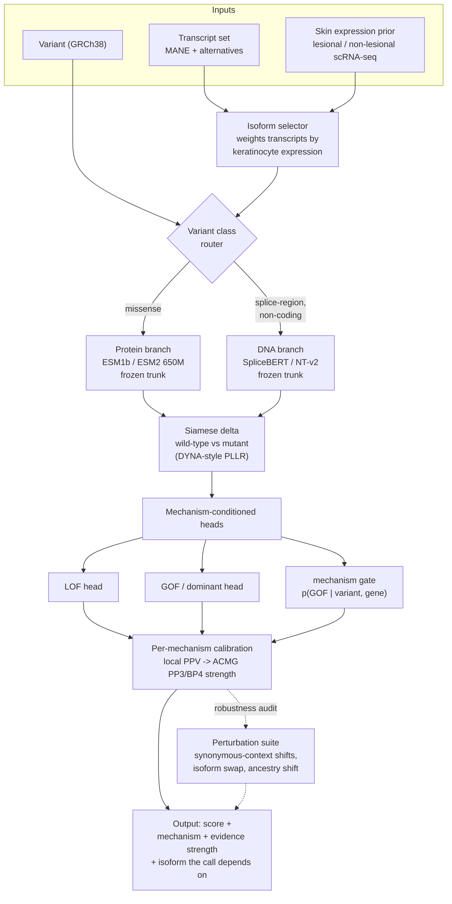

# Mechanism-aware variant effect prediction for the psoriasis spectrum

**Pilot technical report.** Status: exploratory experiments complete, model not yet built.
Date: 2026-10-31. All numbers in this document were produced by the scripts in `src/`
against the data sources listed in [Data](#data); the logs are in `results/`.

---

## 1. Why this problem

Variant effect prediction (VEP) has converged on a strong generic baseline. AlphaMissense
(Cheng et al., *Science* 2023, [DOI](https://doi.org/10.1126/science.adg7492)) classifies 89% of all
possible human missense substitutions as likely benign or likely pathogenic, and ClinGen has
calibrated it to *Strong* evidence for pathogenicity under ACMG/AMP PP3
(Bergquist et al., *Genet Med* 2025, [DOI](https://doi.org/10.1016/j.gim.2025.101402)).

The psoriasis spectrum is a hard case for that baseline, for three structural reasons.

1. **Mechanism is split within one phenotype family.** Generalised pustular psoriasis (GPP) is
   driven by **loss of function**: bi-allelic `IL36RN`
   (Marrakchi et al., *NEJM* 2011, [DOI](https://doi.org/10.1056/NEJMoa1013068); Onoufriadis et al.,
   *AJHG* 2011, [DOI](https://doi.org/10.1016/j.ajhg.2011.07.022)), `MPO` deficiency
   (Haskamp et al., *AJHG* 2020, [DOI](https://doi.org/10.1016/j.ajhg.2020.07.001); Vergnano et al.,
   *AJHG* 2020, [DOI](https://doi.org/10.1016/j.ajhg.2020.06.020)), `AP1S3`
   (Setta-Kaffetzi et al., *AJHG* 2014, [DOI](https://doi.org/10.1016/j.ajhg.2014.04.005)) and
   `SERPINA3` (Frey et al., *JID* 2020, [DOI](https://doi.org/10.1016/j.jid.2019.11.024)).
   Plaque psoriasis, PRP and `CARD14`-associated papulosquamous eruption are driven by
   **gain of function** in `CARD14` (Jordan et al., *AJHG* 2012,
   [DOI](https://doi.org/10.1016/j.ajhg.2012.03.012) and
   [DOI](https://doi.org/10.1016/j.ajhg.2012.03.013); Fuchs-Telem et al., *AJHG* 2012,
   [DOI](https://doi.org/10.1016/j.ajhg.2012.05.010)) — and the *same* gene causes severe
   atopic dermatitis through **loss** of function (Peled et al., *JACI* 2018,
   [DOI](https://doi.org/10.1016/j.jaci.2018.09.002)). One gene, two mechanisms, two diseases.
2. **Generic predictors are known to fail on non-LOF mechanisms.** Gerasimavicius et al.
   (*Nat Commun* 2022, [DOI](https://doi.org/10.1038/s41467-022-31686-6)) showed that nearly all
   VEPs underperform on dominant-negative and gain-of-function variants, which perturb structure
   only mildly. Badonyi & Marsh (*Nat Commun* 2025,
   [DOI](https://doi.org/10.1038/s41467-025-63234-3)) estimate that dominant-negative and
   gain-of-function mechanisms account for **48% of phenotypes in dominant genes**.
3. **Labels are scarce exactly where they matter.** See §3.1: across the five core
   psoriasis-spectrum genes, ClinVar holds **44 pathogenic/likely-pathogenic** entries in total
   against **691 benign** and **957 uncertain**.

This report measures how bad the problem is, before proposing a model. The design follows the
disease-specificity argument of DYNA (Zhan, Moore & Zhang, *Nat Mach Intell* 2025,
7:661–671, [DOI](https://doi.org/10.1038/s42256-025-01016-8)), which fine-tunes genomic
foundation models per disease with a Siamese network and shows that LOF-vs-GOF gene–disease
relationships are what make disease-specific VEP necessary — demonstrated on cardiomyopathy and
arrhythmia, not on immune-mediated skin disease.

---

## 2. Data

| Source | Version | How it was obtained |
|---|---|---|
| ClinVar VCF (GRCh38) | `clinvar_20250504.vcf.gz` | gnomAD public GCS mirror, `gcp-public-data--gnomad/resources/grch38/clinvar/` |
| AlphaMissense, canonical | `AlphaMissense_hg38.tsv.gz` | `dm_alphamissense` GCS bucket (CC BY-NC-SA 4.0) |
| AlphaMissense, all isoforms | `AlphaMissense_isoforms_hg38.tsv.gz` | same bucket |

Gene panel: 30 genes (`src/mech.json`), each annotated with the dominant disease mechanism
reported in the literature — 5 psoriasis-spectrum core genes (`IL36RN`, `MPO`, `AP1S3`,
`SERPINA3`, `CARD14`) plus 25 IL-23/IL-17-axis and autoinflammation comparators.
13,562 ClinVar records fall in these genes; 6,592 are missense; 6,427 (97.5%) carry an
AlphaMissense score; 810 of those have a non-conflicting pathogenic or benign ClinVar label.

**Mechanism labels are gene-level, not variant-level.** This is the main limitation of the pilot
and the first thing the full study must fix (§6).

---

## 3. Results

### 3.1 Label scarcity (`src/extract_clinvar.py`)

ClinVar counts for the five core genes (P = pathogenic/likely pathogenic, B = benign/likely
benign, U = uncertain or conflicting; all variant types):

| Gene | Mechanism | P | B | U |
|---|---|---|---|---|
| `CARD14` | GOF | 15 | 539 | 716 |
| `MPO` | LOF | 16 | 23 | 79 |
| `IL36RN` | LOF | 12 | 73 | 114 |
| `SERPINA3` | LOF | 1 | 33 | 43 |
| `AP1S3` | LOF | 0 | 23 | 5 |

This is the few-shot regime DYNA was designed for: their cardiomyopathy training set was 440
variants, arrhythmia 326. The psoriasis spectrum offers an order of magnitude less.

### 3.2 Experiment 1 — the mechanism blind spot (`src/analyze.py`, `results/exp1_log.txt`)

AlphaMissense on the 810 labelled missense variants. 95% CIs from 2,000 bootstrap resamples.
`sens@AMclass` is sensitivity at AlphaMissense's own `likely_pathogenic` call.

| Stratum | n | P | B | AUROC | AUPRC | sens@AMclass | FPR |
|---|---|---|---|---|---|---|---|
| All genes | 810 | 353 | 457 | 0.938 [0.922, 0.954] | 0.927 [0.903, 0.946] | 0.748 | 0.074 |
| mechanism = LOF | 143 | 27 | 116 | 0.964 [0.912, 0.992] | 0.900 [0.804, 0.970] | **0.852** | 0.086 |
| mechanism = GOF | 212 | 93 | 119 | 0.902 [0.855, 0.947] | 0.883 [0.812, 0.939] | **0.419** | 0.008 |
| mechanism = MIXED | 455 | 233 | 222 | 0.959 [0.941, 0.974] | 0.961 [0.941, 0.976] | 0.867 | 0.104 |
| core 5 genes | 75 | 19 | 56 | 0.970 [0.931, 0.998] | 0.899 [0.761, 0.991] | 0.632 | 0.036 |
| core LOF (4 genes) | 34 | 8 | 26 | 0.966 [0.898, 1.000] | 0.895 [0.653, 1.000] | 0.875 | 0.077 |
| core GOF (`CARD14`) | 41 | 11 | 30 | 0.979 [0.930, 1.000] | 0.946 [0.829, 1.000] | **0.455** | 0.000 |

**The headline.** Ranking quality looks uniformly excellent (AUROC 0.90–0.98 everywhere), but at
the threshold a clinician actually uses, AlphaMissense recovers **85% of loss-of-function
pathogenic variants and 42% of gain-of-function ones**. The false-positive rate in the GOF
stratum is 0.008 — the model is not wrong, it is *silent*: GOF pathogenic variants land in the
same low-score region as benign variants and the calibrated threshold never reaches them. This is
the quantitative form of the warning in Gerasimavicius et al. 2022, and it mirrors the conclusion
of Mathur & Sachidanandam (bioRxiv 2026, [DOI](https://doi.org/10.64898/2026.03.10.710786)) that
"aggregate metrics, especially on imbalanced datasets, substantially overstate clinical readiness".

**Named literature alleles.** The founding psoriasis GOF alleles are missed individually:

| Gene | Variant | ClinVar | AlphaMissense | Call |
|---|---|---|---|---|
| `CARD14` | p.Gly117Ser (PSORS2, familial psoriasis) | Pathogenic | 0.236 | likely_benign |
| `CARD14` | p.Glu138Ala (de novo GPP) | Pathogenic | 0.301 | likely_benign |
| `CARD14` | p.Glu142Lys | Pathogenic | 0.542 | ambiguous |
| `CARD14` | p.Glu142Gly | Pathogenic | 0.412 | ambiguous |
| `CARD14` | p.Met119Thr | Likely pathogenic | 0.732 | likely_pathogenic |
| `IL36RN` | p.Leu27Pro (Tunisian GPP founder) | Pathogenic | 0.782 | likely_pathogenic |
| `IL36RN` | p.Ser113Leu (commonest European GPP allele) | Conflicting | 0.396 | ambiguous |
| `IL36RN` | p.Arg48Trp | Uncertain | 0.247 | likely_benign |
| `IL36RN` | p.Pro76Leu (commonest in Vietnamese GPP after the frameshift) | Conflicting | 0.596 | likely_pathogenic |
| `MPO` | p.Arg569Trp | Pathogenic/LP | 0.924 | likely_pathogenic |
| `AP1S3` | p.Phe4Cys (GPP founder) | Benign/LB | 0.786 | likely_pathogenic |
| `AP1S3` | p.Arg33Trp (GPP founder) | Benign/LB | 0.771 | likely_pathogenic |

Four of the five best-established `CARD14` psoriasis alleles are **not** called pathogenic.
The two `AP1S3` founder alleles go the other way, and deserve care rather than a victory lap:
they are reported as disease alleles with reduced penetrance in Setta-Kaffetzi et al. 2014, but
ClinVar labels them benign/likely benign — plausibly on population frequency. The disagreement is
real and it is a *label* problem, not only a model problem. The psoriasis spectrum does not fit a
binary pathogenic/benign frame; it needs penetrance-aware labels.

Also note `IL36RN` p.Arg10ArgfsX1 (`c.115+6T>C`), the commonest allele in Vietnamese GPP at 44.1%
of patients (Nguyen Thi Thuy et al., *Dermatology* 2024,
[DOI](https://doi.org/10.1159/000541886)) and in Malaysian Chinese GPP at 92% of mutation-positive
cases (Choon et al., *Exp Dermatol* 2023, [DOI](https://doi.org/10.1111/exd.14776)): it is a
splice-region variant, so **no missense predictor scores it at all**. Any psoriasis VEP that
handles only missense variants is structurally blind to the single most common disease allele in
Southeast Asia.

### 3.3 Experiment 2 — mechanism-conditional calibration (`src/exp2_calib_cluster.py`)

Thresholds fitted at a 5% false-positive-rate target, 5-fold stratified CV, comparing a single
global threshold against a per-mechanism threshold.

| Stratum | n | Global threshold: sens (FPR) | Mechanism threshold: sens (FPR) |
|---|---|---|---|
| LOF | 143 | 0.793 (0.043) | 0.793 (0.043) |
| **GOF** | 212 | **0.258** (0.009) | **0.495** (0.042) |
| MIXED | 455 | 0.798 (0.076) | 0.733 (0.045) |

Mechanism-conditional calibration **nearly doubles gain-of-function sensitivity at matched
false-positive rate** and changes nothing for LOF. No new model, no new features — only
conditioning the decision rule on the mechanism. This is the cheapest possible version of the
proposed contribution, and it already works. It also bounds the claim: recalibration moves the
threshold, it does not re-rank variants, so the remaining ~50% of missed GOF variants need actual
mechanism-aware *representation*, not just a better cut-point.

### 3.4 Experiment 3 — positional clustering (inconclusive result)

Gerasimavicius et al. 2022 report that non-LOF variants cluster in 3D. AlphaFold structures were
not reachable from this environment, so this was tested in 1D: for each variant, distance in
residues to the nearest *training-fold* pathogenic variant in the same gene, 5-fold CV on the
four GOF genes (n = 212, 93 pathogenic).

| Feature | AUROC |
|---|---|
| AlphaMissense alone | 0.906 |
| Positional clustering alone | 0.909 |
| Both (logistic regression) | 0.912 |

Read this cautiously. A 1D distance-to-known-pathogenic feature alone matches a 650M-parameter
structural model, which is interesting — but it is also partly circular: in hotspot genes such as
`NLRP3` the known pathogenic positions *are* the answer, and ClinVar supplies them. The
combination gains almost nothing (0.906 → 0.912). **We are not claiming positional clustering as a
contribution.** It is recorded as a test that did not separate the hypotheses, and it is why the
full study needs real 3D structure and a gene-held-out split.

### 3.5 Experiment 4 — isoform instability (`src/exp4_isoform.py`)

Using AlphaMissense's isoform-level table: 4,283 of the panel's missense variants are scored on
more than one transcript.

| Stratum | n | Median score range across isoforms | Class-call flips |
|---|---|---|---|
| All multi-isoform | 4,283 | 0.030 | **13.6%** |
| LOF | 865 | 0.041 | 17.0% |
| GOF | 2,329 | 0.027 | 12.3% |
| MIXED | 1,089 | 0.028 | 13.7% |
| Psoriasis core 5 genes | 726 | 0.037 | **16.1%** |
| `CARD14` | 614 | 0.038 | 16.6% |
| `AP1S3` | 10 | 0.083 | 40.0% |
| ClinVar pathogenic only | 200 | 0.047 | 17.5% |
| ClinVar benign only | 263 | 0.019 | 11.4% |

**One in six psoriasis-spectrum variants changes its clinical class call depending on which
transcript you score.** The extremes are stark: `CARD14` p.Arg386Ser scores 0.080 on one isoform
and 0.984 on another, while sitting in ClinVar as uncertain significance; p.Ala367Pro spans
0.077–0.973; `AP1S3` p.Arg33Trp spans 0.263–0.793. This is consistent with Brandes et al.
(*Nat Genet* 2023, [DOI](https://doi.org/10.1038/s41588-023-01465-0)), who annotated ~2 million
variants as damaging only in specific isoforms, and with Weykopf et al. (*Nat Commun* 2026,
[DOI](https://doi.org/10.1038/s41467-026-74280-w)) on tissue-specific isoform effects. For a
keratinocyte-restricted gene like `CARD14` the question "which isoform is expressed in lesional
skin" is answerable from transcriptomic data and is not currently part of any VEP's input.

---

## 4. System design

The pilot above measures three failure modes. The proposed system is built to address them
directly: mechanism-conditioned heads, a splice-capable branch so Southeast Asian founder alleles
are in scope at all, and isoform selection driven by skin expression.



The three branches of the diagram map onto the three experiments: the **mechanism-conditioned
heads plus per-mechanism calibration** are the thing Experiment 2 showed already pays off; the
**DNA branch** exists because of the `c.115+6T>C` blind spot in §3.2; the **isoform selector**
exists because of Experiment 4. The **robustness audit** is adapted from GenoArmory
(Luo et al., arXiv:2505.10983), which found average attack success rates of 99.00% (BERT-Attack)
and 94.72% (TextFooler) against genomic foundation models and that classification models are more
robust than generative ones — a safety check, not a headline claim, and we would report it as a
stability measurement rather than an adversarial-attack result.

---

## 5. How this differs from current models

| Model | Disease-specific | Mechanism-aware | Isoform-aware | Non-coding | Calibrated to ACMG | Covers psoriasis |
|---|---|---|---|---|---|---|
| AlphaMissense (Cheng 2023) | no | no | partially (separate table, no selection rule) | no | yes, post hoc (Bergquist 2025) | not evaluated |
| ESM1b (Brandes 2023) | no | no | yes (isoform annotations) | no | yes, post hoc | not evaluated |
| EVE (Frazer 2021) | no | no | no | no | no | not evaluated |
| CADD / GPN-MSA (Benegas 2025) | no | no | no | yes | no | not evaluated |
| AlphaGenome (Avsec 2026) | no | no | n/a (regulatory tracks) | yes | no | not evaluated |
| Evo 2 (Brixi 2026) | no | no | no | yes | no | not evaluated |
| LoGoFunc (Stein 2023) | no | **yes** (GOF vs LOF vs neutral) | no | no | no | genome-wide, not disease-conditioned |
| Badonyi & Marsh 2025 | no | **yes** (structure-based mLOF score) | no | no | no | gene/phenotype level, not variant-clinical |
| DYNA (Zhan 2025) | **yes** | implicitly, via disease choice | no | yes (splicing branch) | no | **no** — cardiac + splicing only |
| **This proposal** | yes | explicitly, conditioned heads | yes, expression-driven | yes | yes, per mechanism | yes |

The gap is specific and defensible: **no existing model conditions on mechanism and disease at the
same time**, and the one disease-specific architecture that exists (DYNA) was never applied to an
immune-mediated disease where one gene carries both mechanisms. `CARD14` is the cleanest such gene
in the human genome — gain of function gives psoriasis/PRP, loss of function gives atopic
dermatitis — which makes the psoriasis spectrum the natural test bed rather than an arbitrary new
disease to tick off.

---

## 6. What the pilot does *not* show, and what the full study needs

Honest limitations, in order of severity.

1. **Mechanism labels are gene-level.** Every variant in `CARD14` is treated as GOF, which is
   false (Peled 2018 LOF alleles sit in the same gene). The full study must curate
   variant-level mechanism labels from the functional literature — NF-κB reporter activity for
   `CARD14`, IL-36Ra stability and IL-36R binding for `IL36RN` (30 variants already characterised
   in Hassi et al., *JID* 2023, [DOI](https://doi.org/10.1016/j.jid.2023.06.191)), MPO activity for
   `MPO` — and treat the gene label only as a prior.
2. **n is small and ClinVar labels are noisy.** 11 pathogenic `CARD14` missense variants is not a
   test set. Bootstrap CIs on the core-gene strata reach 1.000. Any claim must rest on the pooled
   mechanism strata plus the named-allele analysis, with the core genes as illustration.
3. **No model was trained.** The environment had no GPU, no PyTorch, and no reachable route to
   ESM, HuggingFace or Zenodo weights, so every number here comes from a *precomputed* predictor.
   Experiments 1–4 are measurements of the baseline's failure modes, not a demonstration that the
   proposed architecture fixes them. Experiment 2 is the only forward-looking result, and it is a
   recalibration, not a model.
4. **One predictor only.** AlphaMissense alone. A publishable version needs ESM1b, EVE, REVEL,
   CADD, PrimateAI-3D and at least one DNA model, following the release guidance of Livesey &
   Marsh (*Genome Biol* 2025, [DOI](https://doi.org/10.1186/s13059-025-03572-z)) and the
   data-circularity cautions in their benchmarking work
   ([DOI](https://doi.org/10.1186/s13059-025-03575-w)).
5. **Ancestry is argued, not measured.** The Vietnamese and Malaysian allele-frequency
   differences are cited from the literature; no cohort was analysed here. gnomAD per-chromosome
   VCFs are ~14 GB and were out of scope for this pilot.
6. **Experiment 3 is confounded** by ClinVar-derived hotspot positions, as described in §3.4.

## 7. Reproducing

```bash
# data (both from public GCS buckets; ~2 GB total)
curl -o data/clinvar_20250504.vcf.gz \
  https://storage.googleapis.com/gcp-public-data--gnomad/resources/grch38/clinvar/clinvar_20250504.vcf.gz
curl -o data/AlphaMissense_hg38.tsv.gz \
  https://storage.googleapis.com/dm_alphamissense/AlphaMissense_hg38.tsv.gz
curl -o data/AlphaMissense_isoforms_hg38.tsv.gz \
  https://storage.googleapis.com/dm_alphamissense/AlphaMissense_isoforms_hg38.tsv.gz

pip install numpy scikit-learn
python src/extract_clinvar.py      # -> out/clinvar_genes.json
python src/join_am.py              # -> out/clinvar_am.json
python src/analyze.py              # Experiment 1   -> results/exp1_log.txt
python src/exp2_calib_cluster.py   # Experiments 2-3 -> results/exp2_exp3_log.txt
python src/exp4_isoform.py         # Experiment 4   -> results/exp4_log.txt
```

AlphaMissense data is CC BY-NC-SA 4.0 (non-commercial). ClinVar is public domain.
